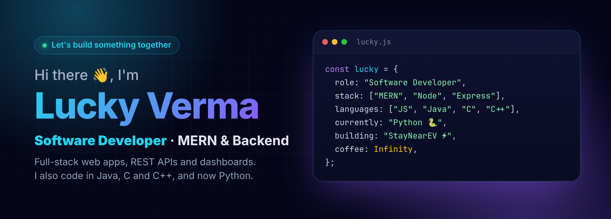

---

## 👋 About me

- 💻 I'm a **software developer**. Most of my work is **MERN and backend**: REST APIs, auth, emails and the dashboards on top of them.
- ☕ I also write **Java, C and C++**: DSA problems, OOP and practice programs ([Java DSA](https://github.com/Luckyverma04/Problem-Solving-Codes-in-java) · [C](https://github.com/Luckyverma04/Training-codes) · [C++](https://github.com/Luckyverma04/training-Cpp)).
- 🐍 Currently working with **Python** and machine learning ([ml-journey](https://github.com/Luckyverma04/ml-journey)).
- 🔭 Building **[StayNearEV](https://github.com/Luckyverma04/StayNearEvFrontend)**, an app to find and book EV charging stations, plus its [Android app](https://github.com/Luckyverma04/Stay-NearEv-APK).
- 💬 Ask me about Node.js, Express, MongoDB, React, JWT auth and DSA.

## 🛠️ Tech stack

**Languages**
 

-3776AB?style=flat-square&logo=python&logoColor=white)

**Backend**
 

**Frontend**
 

**Tools & hosting**
 

---

## 🚀 Featured projects

<table>
<tr>
<td width="50%" valign="top">

<h3>⚡ StayNearEV</h3>
Find and book EV charging stations: map, public chargers, Google login, booking emails and a 3D home page.
  
<a href="https://staynearevfrontend.onrender.com">Live</a> ·
<a href="https://github.com/Luckyverma04/StayNearEvFrontend">Frontend</a> ·
<a href="https://github.com/Luckyverma04/StayNearEv">Backend</a>
</td>
<td width="50%" valign="top">

<h3>🎁 Trazoo</h3>
Corporate gifting platform: website, gift-kit builder, leads CRM, and admin and associate dashboards.
  
<a href="https://trazooglobal.com/">Live</a> ·
<a href="https://github.com/Luckyverma04/TrazooProductsFrontend">Frontend</a> ·
<a href="https://github.com/Luckyverma04/Trazoo-products-backend">Backend</a>
</td>
</tr>
<tr>
<td width="50%" valign="top">

<h3>🔍 BGV Automation</h3>
Background verification with a human in the loop: finds a candidate's public profiles, scores matches and keeps an audit trail.
  
<a href="https://background-verification-software.vercel.app">Live</a> ·
<a href="https://github.com/Luckyverma04/Background_verification_software">Code</a>
</td>
<td width="50%" valign="top">

<h3>🧱 Visual Page Builder</h3>
Drag-and-drop page builder with a live designer and dashboard.
  
<a href="https://visual-page-builder.vercel.app">Live</a> ·
<a href="https://github.com/Luckyverma04/visual-page-builder">Code</a>
</td>
</tr>
<tr>
<td width="50%" valign="top">

<h3>★ LORE</h3>
Next.js website for Lore, an Android app that turns your photo into a share-ready video.
  
<a href="https://lore-website-rho.vercel.app">Live</a> ·
<a href="https://github.com/Luckyverma04/LORE_Website">Code</a>
</td>
<td width="50%" valign="top">

<h3>👨‍💻 Portfolio</h3>
My personal portfolio with a 3D hero, projects, skills and contact.
  
<a href="https://lucky-portfolio-tau.vercel.app">Live</a> ·
<a href="https://github.com/Luckyverma04/Lucky-Portfolio">Code</a>
</td>
</tr>
</table>

### More projects

| Project | What it is |
|---|---|
| [Patel Corp Gifts](https://github.com/Luckyverma04/Major_Project2) + [API](https://github.com/Luckyverma04/backend) | Corporate gifts e-commerce site with an admin panel |
| [StayNearby Explore](https://github.com/Luckyverma04/stay-nearby-explore) | Hotel search and booking: React, TypeScript, Supabase |
| [StayNearEV app](https://github.com/Luckyverma04/Stay-NearEv-APK) | Android app for StayNearEV, built with Expo |
| [ml-journey](https://github.com/Luckyverma04/ml-journey) | My machine learning practice notebooks |

### Practice

[C programs](https://github.com/Luckyverma04/Training-codes) ·
[C++ OOP](https://github.com/Luckyverma04/training-Cpp) ·
[Java DSA](https://github.com/Luckyverma04/Problem-Solving-Codes-in-java) ·
[Employee records in C](https://github.com/Luckyverma04/Training_Codes2) ·
[React practice](https://github.com/Luckyverma04/React)

---

## 📊 GitHub stats

---

**Thanks for visiting! ⚡** Let's connect on [LinkedIn](https://www.linkedin.com/in/lucky-verma-886547307/).

